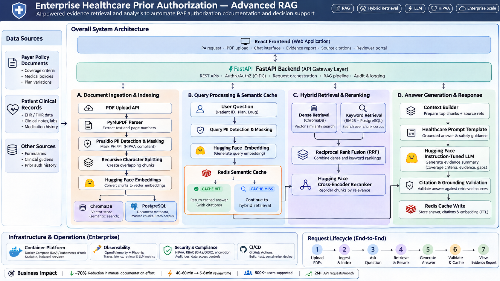
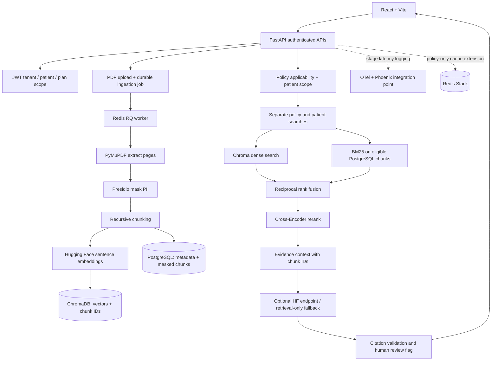

# Enterprise Healthcare Prior Authorization — Hybrid RAG (Reference Implementation)




## Business use case
A provider requests prior authorization for Drug X for patient P123 enrolled in PLAN_A. The insurer needs to find the effective policy for Drug X, its criteria, and patient notes showing diagnosis and previous treatment. The assistant retrieves applicable policy excerpts and only the authorized patient's records, ranks them, and produces a cited evidence summary. The claim of 70% less documentation work is a resume claim **not measured by this prototype**.

## Architecture



**Pipelines:** (A) ingestion = upload → PyMuPDF → Presidio → chunking → HF embeddings → Chroma and PostgreSQL; (B) query = authentication → plan/patient scope → dense + BM25 → RRF → cross-encoder → prompt → model → citation verification → reviewer report. Redis semantic cache and Phoenix are **extension points**, not fully integrated/verified features.

## Files and responsibilities

- `backend/app/api/`: `/api/chat`, uploads, document listing, job status and health
- `backend/app/ingestion/`: PDF text, masking, chunking, queue pipeline
- `backend/app/retrieval/`: sentence embeddings, Chroma, BM25, RRF, reranking
- `backend/app/generation/`: prompt, optional Hugging Face inference, validation, response
- `backend/app/privacy/`: Presidio integration; fails closed if masking disabled
- `backend/app/cache/`: Redis client and policy-only exact cache foundation; semantic cache is not yet implemented
- `backend/app/database/`: SQLAlchemy document/chunk/job/session records
- `backend/app/workers/`: Redis RQ asynchronous ingestion worker
- `backend/app/observability/`: stage timings; export to Phoenix is not yet implemented
- `frontend/`: React upload, status checks, question form and evidence reports
- `samples/`: fictional clinical/policy text, PDF generator

## Seven Docker Compose services

| Service | Purpose | Host port |
| --- | --- | --- |
| frontend | React + Vite | 5173 |
| backend | FastAPI | 8000 |
| worker | RQ ingestion worker | none |
| postgres | scoped metadata and BM25 source corpus | 5432 |
| redis | work queue; policy cache foundation | 6379 |
| chroma | vector database | 8001 |
| phoenix | tracing dashboard provisioned, integration pending | 6006 |

## Quickstart (requires Docker Compose)

1. Copy `.env.example` to `.env`; set a random `JWT_SECRET` at least 32 characters long.
2. Run `docker compose up --build`. The first boot downloads embedding, reranker, and Presidio models, which may require memory and internet access. This stack has **not been integration-tested in this environment**.
3. Generate a local-only token: `JWT_SECRET='same-secret-as-env' python scripts/create_demo_token.py` (requires PyJWT locally), and paste it into the React UI at `http://localhost:5173`. This local token helper is not a production identity provider.
4. Install PyMuPDF locally (`pip install PyMuPDF`) and generate PDFs with `python scripts/create_sample_pdfs.py`.
5. Upload `samples/policy.pdf` with kind `policy`, plan `PLAN_A`, drug `DRUG_X`. Upload `samples/patient.pdf` with kind `patient`, patient `P123`. Wait until each `/api/ingestion/{job_id}` reports `ready`.
6. In the Evidence Search tab ask *Does the available evidence support the documented Drug X coverage criteria?*
7. Without `HF_ENDPOINT_URL`, the system returns retrieved citations with `mode: retrieval_only`, **not a fake clinical determination**. If you configure a suitable HF chat-completions endpoint and token, it attempts a structured JSON evidence comparison, subject to the validation limits below.

### API shape

```http
POST /api/documents/upload       multipart: kind, file, patient_id OR plan_id + drug_id
GET  /api/documents              documents caller may access
GET  /api/documents/{id}         one document
DELETE /api/documents/{id}       intentionally 501 pending safe delete implementation
GET  /api/ingestion/{job_id}     queued / processing / ready / failed
POST /api/chat                   patient_id, plan_id, drug_id, question, optional as_of
GET  /api/chat/sessions
GET  /api/chat/sessions/{id}
GET  /health
```

Sample request:

```json
{"patient_id":"P123","plan_id":"PLAN_A","drug_id":"DRUG_X","question":"What evidence supports the requirements?"}
```

Response fields include `summary`, `criteria`, `missing_information`, `source_citations`, `mode`, and `requires_human_review`.

## Core data model

| Table | Purpose |
| --- | --- |
| `documents` | tenant, policy/patient document type, policy version, effective date, plan, patient, drug, status |
| `document_chunks` | masked source text, document FK, page and scope, stable chunk IDs |
| `ingestion_jobs` | job state and errors |
| `chat_sessions` | authorized user + patient + tenant |
| `chat_messages` | question and response summary; avoid raw PHI without approved retention rules |

**Data placement:** source PDFs → local mounted volume (prototype only); chunks and metadata → PostgreSQL; embeddings → ChromaDB; queue → Redis; cache foundation → Redis Stack; traces → structured log timers (Phoenix integration pending). Clinical PHI must not go to uncontrolled logs or caches.

## What still needs to be done for an enterprise deployment

1. **Authorization:** This scaffold validates a signed local JWT with patient/plan claim lists. Replace with OIDC/JWKS, server-side member-plan eligibility, auditable RBAC/ABAC, short-lived access, tenant isolation and request authorization. Never accept client-supplied plan identifiers as sufficient proof that a policy applies.
2. **Policy correctness:** Build a policy resolver using exact payer, product, drug code, effective date, jurisdiction, network and benefit terms. Handle overlapping versions and conflicts deterministically. Test plan applicability independently of vector similarity.
3. **Vector access:** Current Chroma tenant-level search with post-filtered chunk IDs is safe against returning out-of-scope IDs but can *miss* relevant records under large corpora and can become expensive. Push restrictive tenant+patient or policy/plan filters into Chroma, build separate policy/patient collections and use an index design evaluated under load.
4. **BM25 scaling:** Current request-time rank_bm25 rebuilds from eligible PostgreSQL chunks. Use a persistent BM25 index or search engine with access filters, versioning, and incremental updates for production workloads. Vanilla PostgreSQL full-text search is not automatically BM25.
5. **PII/PHI:** Presidio masking is not a guarantee of HIPAA de-identification. Add PHI classification, measured redaction recall, human review where necessary, approved storage and model vendors, encryption, retention/deletion policies, backups and BAAs where applicable. Do not send real PHI to a public model endpoint without appropriate agreements and controls.
6. **LLM and validation:** Hard-validate the JSON schema, enforce evidence spans and source offsets, run claim/entailment checks, use abstention, and add mandatory clinician review before consequential decisions. Citation-ID existence does not prove groundedness. The example endpoint is not clinical-accuracy validated.
7. **Operations:** Alembic migrations; idempotent jobs and retry/DLQ; atomic index publishing; secure and idempotent deletion across PDF, SQL and vector stores; policy invalidation and cache invalidation; transaction/outbox consistency; backpressure; health/readiness probes and resource limits.
8. **Observability:** Connect OpenTelemetry trace exporters, Phoenix, model latency/cost counters, retrieval recall and NDCG, citation faithfulness and PHI-safe logging; protect observability data with retention/access policy.
9. **Semantic cache:** Implement Redis Stack vector query with strict tenant, plan, policy version, question type and time validity; avoid cross-patient answer reuse. Currently only the exact-key policy-only cache primitives exist, and they are not wired to `/api/chat`.
10. **Deployment:** Docker Compose is a local demonstration, not highly available infrastructure. For production use managed PostgreSQL/Redis, protected object storage, autoscaling workers, a protected vector service, model hosting and deployment rollbacks.
11. **Tests and evaluation:** Synthetic/fictitious evaluation set with expert-labeled policy passages and patient evidence; Recall@K, Precision@K, NDCG, criterion extraction precision/recall, citation entailment, missing evidence detection, P95 latency and documentation time saved. Execute adversarial isolation, policy-version, wrong-plan, prompt-injection and PHI-leak tests.

## Run unit tests

```bash
cd backend
pytest -q
```

Expected tests cover page/chunk tracking, BM25/RRF ranking, cache scope keys and hallucinated citation IDs. They do not replace system/integration/clinical acceptance tests.


